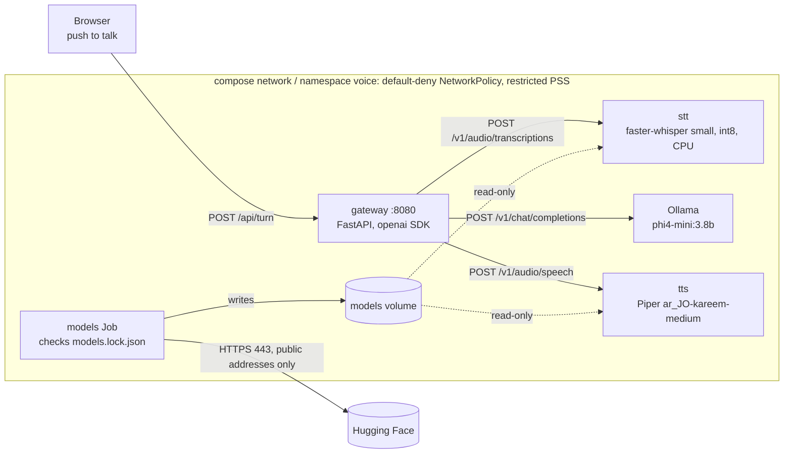
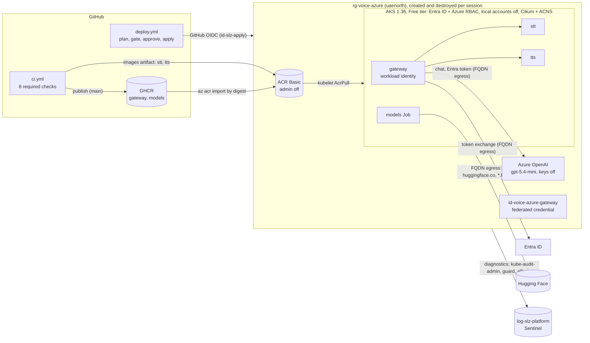

# arabic-voice-assistant

A push-to-talk voice assistant that listens and answers in Arabic, built from open components: **faster-whisper** turns the question into text, an LLM writes a short answer, **Piper** speaks it. The same code runs as processes on a laptop, in Docker Compose, on minikube with Helm, and on AKS, where the answer comes from Azure OpenAI through a workload identity and every Azure resource is created and destroyed by CI.

Why: a portfolio project for speech AI on Kubernetes. It shows what a CPU-only Arabic voice turn costs in time on a laptop and on one cloud node, and how to run it on AKS without a single key: Entra ID everywhere, egress allowed by host name, images by digest, and policy gates that a known-bad change must fail.

**Status: done (M1–M9).** Measured on minikube (M5) and on AKS (M8); the Azure stack exists only during a session and was destroyed the same evening. Design choices: [docs/decisions.md](docs/decisions.md), one line each in [docs/decisions-index.md](docs/decisions-index.md).

## Architecture

On the laptop (`docker compose`) and on minikube (Helm chart `deploy/charts/voice`, namespace `voice`):

On Azure (`infra/` Terraform, applied by `deploy.yml`; the chart with `deploy/azure-values.yaml`):

The speech services speak OpenAI's audio routes, so the gateway uses one `openai` client for all three steps and any of them can be replaced by a hosted service by changing a URL (D10).

## Results: minikube against AKS

The same 20 recorded questions (`own` set: 14 Modern Standard Arabic, 6 Gulf dialect, D15), one warm-up turn not counted, Whisper small with 3 threads in both. Time from the end of the question to the start of the answer audio, p90 over the 20 turns; the budget is D18's.

| | minikube (M5): laptop i7-9750H, 6 cores | AKS (M8): 1 × Standard_F8als_v6, 8 cores | Budget |
|---|---|---|---|
| Turn p90 / p50 | 9.71 s / 5.19 s ([m5-turns.md](docs/evidence/m5-turns.md)) | **3.34 s / 2.90 s** ([m8-turns.md](docs/evidence/m8-turns.md)) | 7 s |
| Speech to text p90 | 2.80 s ([m5-turns.md](docs/evidence/m5-turns.md)) | 1.36 s ([m8-turns.md](docs/evidence/m8-turns.md)) | 2.5 s |
| Answer p90 | 5.57 s, phi4-mini on Ollama ([m5-turns.md](docs/evidence/m5-turns.md)) | 1.90 s, gpt-5.4-mini, reasoning low ([m8-turns.md](docs/evidence/m8-turns.md)) | 3.5 s |
| Text to speech p90 | 0.95 s ([m5-turns.md](docs/evidence/m5-turns.md)) | 0.26 s ([m8-turns.md](docs/evidence/m8-turns.md)) | 0.8 s |
| Autoscaler on `stt` | 1 → 2 → 1; the second replica didn't add throughput on 6 cores ([m5-hpa.md](docs/evidence/m5-hpa.md)) | 1 → 2 → 1; 10–12 → 14–20 calls per 15 s, median 5.6 → 3.2–4.5 s ([m8-hpa.md](docs/evidence/m8-hpa.md)) | — |
| Network flows as expected | 44/44, Calico NetworkPolicy ([m5-netpol.md](docs/evidence/m5-netpol.md)) | 53/53, Cilium with FQDN policies ([m8-netpol.md](docs/evidence/m8-netpol.md), [m8-fqdn.txt](docs/evidence/m8-fqdn.txt)) | — |
| Cost | the laptop | $2.16 for both M8 evenings, about $0.65 per node-hour ([m8-cost.txt](docs/evidence/m8-cost.txt)) | lab budget $20/month |

On AKS every stage is within budget, the first time the whole turn is (D55). The node is faster per thread than the laptop, gpt-5.4-mini answers faster than phi4-mini on a laptop CPU, and two `stt` replicas fit in 8 real cores (D42). The M8 session itself (apply 8.5 min, deploy-chart 14.4 min, destroy 10.2 min) and its first, failed evening are in [m8-session.md](docs/evidence/m8-session.md) and [m8-try1.txt](docs/evidence/m8-try1.txt) (D53, D54).

### Azure AI Speech on the same cluster (M9, optional, D59–D60)

The gateway switched between its own speech pods and Azure AI Speech (ar-BH, voice `ar-BH-AliNeural`) on one running release; the same 20 recordings, each sent as the same 16 kHz WAV ([m9-speech.md](docs/evidence/m9-speech.md)).

| | stt and tts pods | Azure AI Speech | Budget |
|---|---|---|---|
| Speech to text p90 | 1.35 s | 1.58 s | 2.5 s |
| Text to speech p90 | 0.30 s | 1.19 s | 0.8 s |
| Turn p90 | 3.37 s | 4.25 s | 7 s |
| CER / WER, all 20 | 9.9 % / 18.3 % | 7.6 % / 11.3 % | — |

Keyless through the gateway's workload identity (Speech User on one account), by exact host name only ([m9-netpol.md](docs/evidence/m9-netpol.md)); the session and its cost: [m9-session.md](docs/evidence/m9-session.md), [m9-cost.txt](docs/evidence/m9-cost.txt).

Earlier measurements: Whisper small against large-v3-turbo on real speech and four small chat models on 24 Arabic questions ([m3-summary.md](docs/evidence/m3-summary.md), D16, D17); the turns through compose ([m4-turns.md](docs/evidence/m4-turns.md); see the known limits); the images and their scans ([m4-images.md](docs/evidence/m4-images.md), `m4-trivy-*.txt`); Ollama's cold load and how the services stop ([m5-ollama-load.md](docs/evidence/m5-ollama-load.md), [m5-stop.md](docs/evidence/m5-stop.md)); on AKS the workload identity, the operator's access and the logs in the platform workspace ([m8-identity.txt](docs/evidence/m8-identity.txt), [m8-access.txt](docs/evidence/m8-access.txt), [m8-logs.txt](docs/evidence/m8-logs.txt)).

## Run it

### Locally with Docker Compose

Needs Docker with Compose, and on first use about 550 MB of model downloads, 2.5 GB for the chat model and a few minutes of image builds.

    docker compose build
    docker compose run --rm models
    docker compose up -d ollama
    docker exec voice-ollama ollama pull phi4-mini:3.8b
    docker compose up -d --wait

`up --wait` returns once Ollama has the chat model in memory (its health check loads it, a few minutes on a laptop CPU). Open http://localhost:8080, hold the button (or the space bar), ask a question in Arabic, let go. Without a browser: `curl -s -F file=@question.wav http://127.0.0.1:8080/api/turn | jq 'del(.audio)'`.

| Service | Image | Port on 127.0.0.1 | Memory limit |
|---|---|---|---|
| `models` (runs once) | `voice-models:local` | — | 512 MB |
| `stt` | `voice-stt:local` | 8001 | 2048 MB |
| `tts` | `voice-tts:local` (the only image with Piper) | 8002 | 1024 MB |
| `gateway` | `voice-gateway:local` | 8080 | 256 MB |
| `ollama` | `ollama/ollama`, pinned by digest | 11434 | 4480 MB |

Without rebuilding images (development): `uv sync`, `uv run python scripts/fetch_models.py stt-small tts-ar-kareem-medium`, `docker compose up -d ollama`, then one terminal each for `uv run uvicorn --factory voice.services.stt_app:create_app --port 8001`, `… tts_app:create_app --port 8002` and `… gateway_app:create_app --port 8080` (compose services stopped: same ports).

### On minikube

Needs minikube with Calico and metrics-server, kubectl, Helm 4, the images from `docker compose build`, and compose stopped (same memory, same port 8080). The values in `deploy/charts/voice/values.yaml` are for a 12-CPU, 10 GiB minikube; `ollama.modelId` pins the chat model.

    minikube start --driver=docker --container-runtime=containerd --cpus=12 --memory=10g --cni=calico --addons=metrics-server
    for i in stt tts gateway models; do minikube image load voice-$i:local; done
    kubectl apply -f deploy/namespace.yaml
    helm install voice deploy/charts/voice -n voice --wait --timeout 30m
    helm test voice -n voice --logs
    kubectl -n voice port-forward svc/gateway 8080:8080

The chart adds to compose: startup, readiness and liveness probes, CPU and memory requests, an autoscaler for `stt` (1–2 replicas), the restricted Pod Security Standard for every pod (Ollama included), and network policies that deny everything a turn doesn't need (`scripts/check_netpol.py` checks them from inside the pods).

### On Azure (AKS), through CI

Nothing on Azure is applied from the laptop. `scripts/ci-deploy.sh` dispatches `deploy.yml`, shows the plan, approves the `azure` environment and follows the run:

    ./scripts/ci-deploy.sh apply                           # plan, policy gate on that plan, approve, apply it (16 resources)
    ./scripts/ci-deploy.sh deploy-chart <ci.yml run id>    # CI's tested images to ACR, helm upgrade, helm test, 53 flows
    ./scripts/aks-deploy.sh settings && ./scripts/aks-deploy.sh credentials    # your kubectl: namespace voice only
    kubectl -n voice port-forward svc/gateway 8080:8080
    ./scripts/ci-deploy.sh destroy                         # the same evening
    ./scripts/cost.sh <session date>                       # the next day

Prerequisites (once): Project 1's bootstrap holds the federated credentials for this repository and the roles the stack assigns in its ABAC list; the repository has the `azure` environment, the OIDC client ids and `TF_PLAN_KEY` as secrets. Before an apply: the lab budget, Falsv6 quota in uaenorth, the chat model's lifecycle, and after the apply that the node pool has no LocalDNS profile (D53). The M8 session step by step, with what each command printed: [m8-session.md](docs/evidence/m8-session.md).

## CI and gates

`.github/workflows/ci.yml` runs on every pull request and push to `main`, and weekly. `main` is protected: a pull request with these 8 checks green, admins included, linear history.

| Check | What it proves |
|---|---|
| `lint` | ruff format and lint, `uv.lock` in sync |
| `unit` | the unit tests, including the Terraform ↔ chart contract (`test_infra_contract.py`) and the decisions index (`test_decisions.py`) |
| `tests-must-fail` | 30 known-bad code, Terraform-default and decision-file changes, each of which must turn the tests red (D35) |
| `chart` | `helm lint`, Conftest (37 rules) on five renderings of the chart (the fifth with Azure AI Speech), and 32 known-bad chart changes that must be denied |
| `images` | build, image rules (`check_images.py`: no models inside, one dependency group per image, non-root), Trivy: no fixable High or Critical |
| `e2e` | k3s 1.36 on the runner, the chart with Whisper tiny and a fixed-answer chat stand-in, `helm test`, 44 network flows |
| `iac-static` | `terraform fmt` and `validate` for both envs, Checkov 3.4.3, 32 Conftest policy tests |
| `iac-plan` | the full-stack plan against the floci-az emulator (19 resources with the optional Speech account), Conftest (28 rules), 29 known-bad plans that must be denied |

On `main`, `publish` pushes `ghcr.io/salmanamn/voice-gateway` and `voice-models`; the weekly run rescans `main` and reports base-image tags that moved. `deploy.yml` plans `envs/azure` on every PR that touches infra or the chart, and runs Conftest on that exact plan again before any apply. Locally: `uv run python scripts/tests_must_fail.py`, `python3 scripts/chart_must_fail.py` (Helm and Conftest: `./scripts/ci-tools.sh helm conftest`), `./scripts/iac.sh static | gate`.

## Security model

- **Identities.** CI: GitHub OIDC to Project 1's `id-slz-plan` (plans, read-only plus a refresh role) and `id-slz-apply` (applies the approved plan; may assign only the roles on its ABAC list). The gateway: a user-assigned identity, reached through a federated credential for exactly `system:serviceaccount:voice:gateway`. The nodes: AKS's kubelet identity. You: the operator, an Entra user.
- **Roles, by id, at the narrowest scope** (D46; Conftest rejects any other): kubelet `AcrPull` on the registry; gateway `Cognitive Services OpenAI User` on the account; CI's apply identity `AKS RBAC Cluster Admin` on the cluster (to install the chart); the operator `AKS RBAC Admin` on `namespaces/voice` and `OpenAI User`. The operator can't see nodes or `kube-system`, can't create namespaces, and gets no admin kubeconfig ([m8-access.txt](docs/evidence/m8-access.txt)).
- **No keys anywhere.** Azure OpenAI local auth off; ACR admin user and anonymous pull off, no pull secret; AKS local accounts off (kubelogin with Entra ID); the gateway's service account mounts no Kubernetes token, only the projected workload identity token ([m8-identity.txt](docs/evidence/m8-identity.txt)); the Terraform plan travels encrypted between the plan and apply jobs.
- **Network.** Default deny in both directions; each flow a turn needs is opened by name of the pod. On AKS the downloads and the gateway reach only named hosts (Cilium FQDN policies, DNS filtered to those names); no `*`, no address ranges (D44).
- **Workloads.** Restricted Pod Security Standard for every pod, read-only root filesystems, all capabilities dropped, non-root uid 10001; images by digest from the stack's ACR; models checked against `models.lock.json` by every pod that mounts them (D20, D24).
- **Audit.** AKS `kube-audit-admin` and `guard`, ACR and Azure OpenAI `allLogs` to the platform workspace, where Project 2's Sentinel rules run ([m8-logs.txt](docs/evidence/m8-logs.txt)). Expected alerts per session: SLZ-010 for the gateway's federated credential; AKS's own role assignment write is allowlisted as a first-party principal.
- **Evidence.** Files under `docs/evidence/` are masked by the command that writes them: subscription id, the operator's sign-in name, the last octet of every IPv4 address.

## Known limits

- **Licence (D23, open).** The repository has no licence file. `stt` (PyAV bundles GPL encoders) and `tts` (Piper, GPL-3.0-or-later) are not published to GHCR; the deploy job pushes CI's tested bytes from the workflow artifact to the stack's private ACR (D38), so a deploy must use a `main` run from the last 30 days.
- **Kubernetes 1.36, not 1.37 (D53, workaround).** From 1.37 AKS turns LocalDNS on for a new node pool, pods send DNS to the node, and the DNS rules (CoreDNS pods only) drop every lookup. azurerm 4.81 can't set the LocalDNS profile; a Conftest rule keeps the cluster below 1.37.
- **Entra sign-in logs.** A Free tenant shows them in the portal for 7 days and can't export them; the workload identity's sign-in line wasn't recorded, and Azure OpenAI's request log carries no caller object id (D56).
- **Not captured in M8:** the guard log query, the IPv4 port-80 test (only IPv6's "network unreachable" was recorded), how long the images step took (so whether D51's re-sign-in was needed), FailedScheduling events (D54–D56).
- **Compose baseline.** The compose run ([m4-turns.md](docs/evidence/m4-turns.md), p90 14.08 s) was on a busy laptop and was never repeated on an idle one (D21); minikube is the local reference.
- **Chat scoring (D17).** "Correct" means an accepted answer appears in the reply, so it is an upper bound; 24 questions find only gross differences; the prompt's "ask to repeat" clause costs some models Q20.
- **Scope.** Arabic only, push-to-talk, one utterance in and one out, no streaming and no conversation memory (D1, D5, D10). One node with no surge room (D42); public API server and public, Entra-only endpoints (private endpoints are Project 7's).
- **Azure AI Speech (D59, D60)** is an optional backend of the gateway, compared once on AKS (above). Short-audio recognition takes 16 kHz WAV or Ogg Opus only, so the WebM that Chrome records on the page needs the pods.

## Decisions

[docs/decisions.md](docs/decisions.md) holds every design choice with its reason (D1–D59), [docs/decisions-index.md](docs/decisions-index.md) one line each with its status. The index is generated by `scripts/decisions_index.py`; the `unit` job fails when it is stale or a number is missing or repeated.